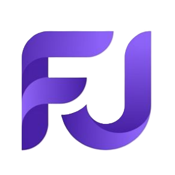

<div align="center">



# Faber UI

**Motion-crafted React components — engineered, not decorated.**

60 components on Base UI primitives and Tailwind CSS v4 where every interaction ships considered motion: one shared easing/duration scale, enter _and_ exit transitions, reduced-motion that's gentler instead of gone. Vendored into your repo with the shadcn CLI — zero runtime dependencies.

[](./LICENSE)
[](https://nextjs.org)
[](https://react.dev)
[](https://tailwindcss.com)
[](https://base-ui.com)

[Live demo](https://faber-ui.vercel.app) · [Documentation](https://faber-ui.vercel.app/docs) · [Components](https://faber-ui.vercel.app/docs/components/button) · [Theming](https://faber-ui.vercel.app/docs/theming) · [Report a bug](https://github.com/SujalXplores/faber-ui/issues/new?template=bug_report.yml) · [Request a component](https://github.com/SujalXplores/faber-ui/issues/new?template=component_request.yml)

```bash
pnpm dlx shadcn@latest add https://faber-ui.vercel.app/r/button.json
```

</div>

---

## Motion is the feature

Most kits animate the demo and ship static defaults. Here motion is load-bearing — every interactive component draws from one scale, and contributions pass animation review before they merge:

- **One scale, everywhere.** 7 named easings and 7 duration steps (plus a 45ms stagger), consumed as tokens — components never hardcode a curve or a millisecond value.
- **No ease-in on enter.** The scale deliberately omits a general ease-in: it delays the first frame, the exact moment the user is watching, so anything entering would read as sluggish.
- **Exits exist.** Menus, dialogs, and popovers ship exit transitions, not just entrances — nothing vanishes in a hard cut.
- **Never `transition-all`.** Named properties only, so an unrelated layout change applies instead of animating by accident.
- **Reduced-motion keeps comprehension.** Distances collapse to zero and durations shorten, but the opacity cues that aid understanding stay. Gentler, not gone.

## You own the source

| Traditional library                                 | Faber UI                                               |
| --------------------------------------------------- | ------------------------------------------------------ |
| `npm install @acme/react` adds a runtime dependency | `shadcn add …/r/button.json` copies source             |
| Theming through provider props and CSS overrides    | Theming through data attributes and CSS tokens         |
| Breaking majors force rewrites                      | You own the file: edit it, delete parts, keep shipping |
| The bundle carries what you don't use               | The bundle carries exactly what you vendored           |

## Quick start

`npx`, `yarn dlx` and `bunx` work the same way. The CLI reads your `components.json` for aliases, resolves dependencies between components, installs the npm packages the item needs, and copies the source into your project.

```tsx
import { Button } from "@/components/ui/button";

export default function Example() {
  return <Button>Continue</Button>;
}
```

Every component is addressed the same way: `https://faber-ui.vercel.app/r/<name>.json`.

## Features

- **Accessible by default.** Base UI primitives under every interactive component handle focus, portals and keyboard support.
- **shadcn-compatible API.** Variants, sizes and composition follow the conventions you already know.
- **Token-based theming.** 1,170 themes (13 hues × 5 neutrals × 6 radii × 3 densities) from 122 semantic tokens on an `oklch` ramp.
- **RTL ready.** Right-to-left layouts work across the whole kit.
- **One icon set.** Remixicon is wired into every component that needs an icon.
- **Live docs.** A Fumadocs site where every preview runs the real component — toggle it, drag it, it's the source.

<details>
<summary><strong>All 60 components</strong></summary>

<br/>

Accordion · Alert · AlertDialog · AspectRatio · Attachment · Avatar · Badge · Breadcrumb · Bubble · Button · ButtonGroup · Calendar · Card · Carousel · Chart · Checkbox · Collapsible · Combobox · Command · ContextMenu · Dialog · Direction · Drawer · DropdownMenu · Empty · Field · HoverCard · Input · InputGroup · InputOTP · Item · Kbd · Label · Marker · Menubar · Message · MessageScroller · NativeSelect · NavigationMenu · Pagination · Popover · Progress · RadioGroup · Resizable · ScrollArea · Select · Separator · Sheet · Sidebar · Skeleton · Slider · Sonner · Spinner · Switch · Table · Tabs · Textarea · Toggle · ToggleGroup · Tooltip

</details>

## Theming

Every visual decision resolves through a token: primitives (hue, chroma, radius, ramps) → presets → typography, motion, elevation → semantic (`--primary`, `--muted`, `--border`) → Tailwind utilities. Components consume the semantic layer only, so `bg-primary` follows a theme change and nothing hardcoded can drift.

```html
<html data-brand="emerald" data-neutral="stone" data-radius="lg"></html>
```

See the [theming guide](https://faber-ui.vercel.app/docs/theming) for the full system.

## Development

A pnpm + Turborepo monorepo. It needs Node 22+ (`.nvmrc` pins 22) and pnpm 12+.

| Workspace       | Path          | Purpose                                                   |
| --------------- | ------------- | --------------------------------------------------------- |
| `@workspace/ui` | `packages/ui` | Components, hooks, utils, styles and the registry builder |
| `web`           | `apps/web`    | The Next.js 16 documentation site                         |

```bash
pnpm install
pnpm dev          # docs on localhost:3000, UI edits reload live
pnpm registry     # rebuild apps/web/public/r from packages/ui/src
pnpm lint && pnpm format && pnpm build && pnpm typecheck && pnpm test
```

- Add a component from `packages/ui` with `pnpm dlx shadcn@latest add <name>`; the export map updates itself.
- Run `pnpm registry` after adding, renaming or changing imports. CI fails on a stale registry, and dependency versions come from `packages/ui/package.json`.
- Add a changeset with `pnpm changeset` (patch for fixes and additions, minor for changes consumers must adapt to, `--empty` for no release).

## Contributing

See [`CONTRIBUTING.md`](./CONTRIBUTING.md). In short: build on Base UI primitives, style with the design tokens (hardcoded colors get sent back), name things so comments are unnecessary, and put motion through the shared scale. Bugs and component ideas go in [issues](https://github.com/SujalXplores/faber-ui/issues/new/choose).

## License

MIT, see [`LICENSE`](./LICENSE).
